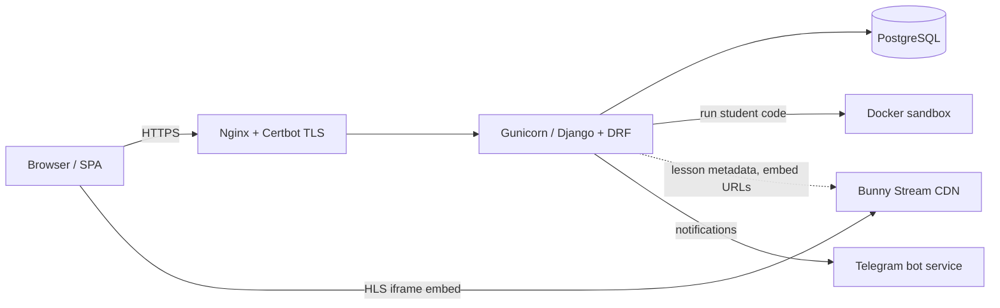
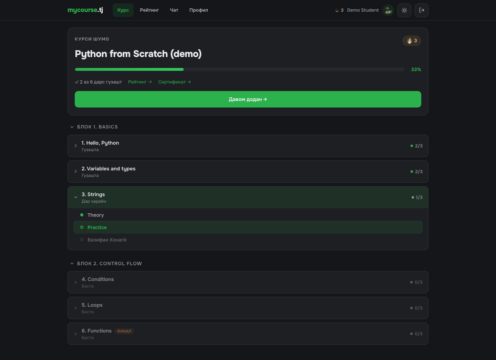
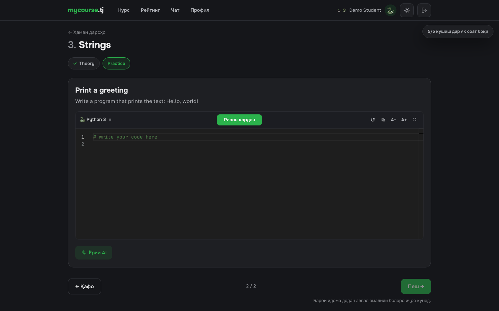
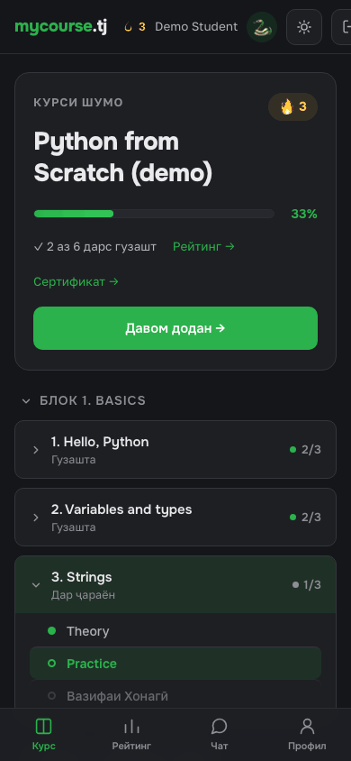
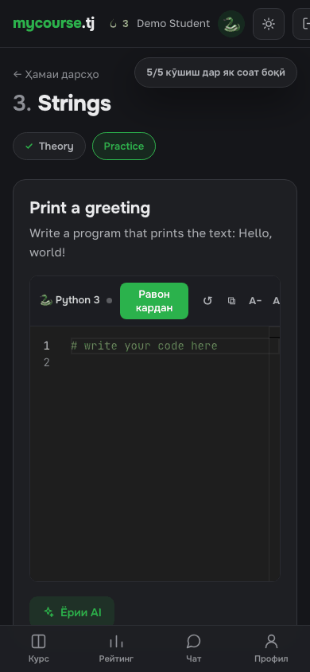
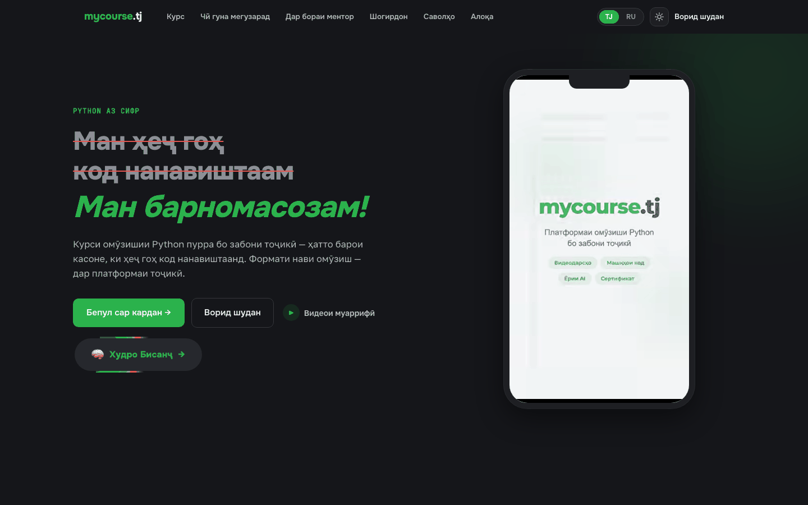
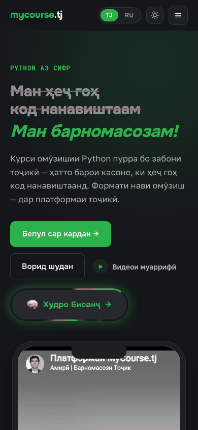
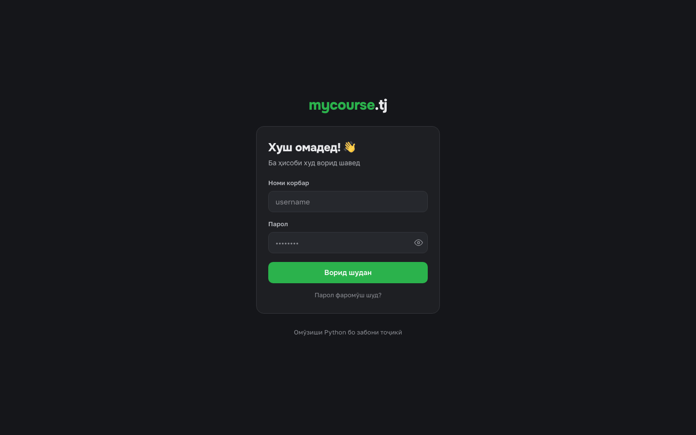
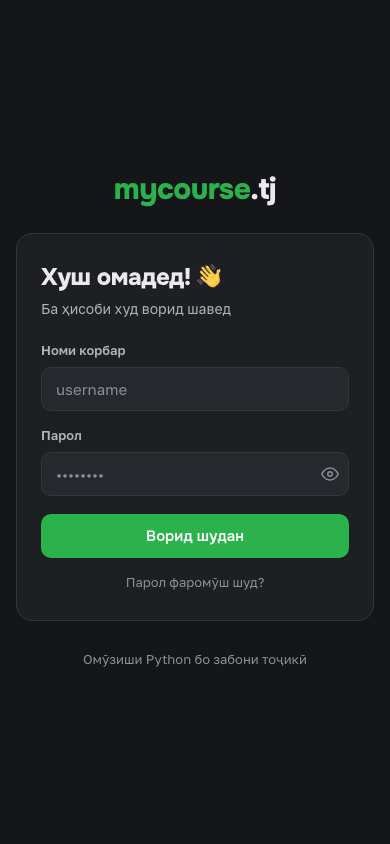

# MyCourse — Django LMS

**A Django-based LMS powering a 120+ lesson Python course.** Live at **[mycourse.tj](https://mycourse.tj)**.

> This repository contains **selected modules only**. The full platform source code is private.

## My role

Sole developer: architecture, backend, infrastructure and deployment.

## Results

- 120+ video lessons
- 55 paid students in the first three months of sales

## Tech stack

Python · Django · Django REST Framework · PostgreSQL · Docker · Bunny Stream (HLS) · Nginx · Gunicorn · Hetzner · Certbot · React (Vite)

## Architecture



## Engineering highlights

- **Sandboxed code execution.** Homework is "write Python, get instant feedback", so the platform runs untrusted code in throw-away Docker containers: no network, read-only FS, dropped capabilities, non-root, CPU/memory/PID caps, capped output, and the *container* (not just the client) killed on timeout. → [`modules/code-sandbox`](modules/code-sandbox)
- **HLS video delivery (and the Referer issue).** Lessons are streamed through Bunny Stream's embed player. Playback worked on desktop but failed with HTTP 403 on iOS Safari: the library's Referrer Allowlist rejected the request because of the `Referer` the browser sent from the SPA. The fix was to load the player iframe with `referrerPolicy="no-referrer"`, which makes the request behave identically across browsers; the same flag is required for any WebView client.
  ```jsx
  <iframe src={embedUrl} referrerPolicy="no-referrer"
          allow="autoplay; encrypted-media; picture-in-picture; fullscreen" allowFullScreen />
  ```
- **Tiered access.** Sequential lesson unlocking plus a time- and scope-limited trial, expressed as pure, unit-tested functions that return a *reason* (so the UI can show the right upsell). → [`modules/trial-access`](modules/trial-access)
- **API hardening.** Fail-closed service API key, throttles that record blocks for operators, and a secret filter in front of the third-party AI grader. → [`modules/api-hardening`](modules/api-hardening)
- **Notifications.** Reminders and progress nudges are delivered by an asynchronous Telegram bot running as a separate service alongside the web app.
- **Migration to Hetzner.** Moved the production stack to Hetzner (Nginx + Gunicorn under systemd, PostgreSQL, Certbot-managed TLS, automated deploys).

## Included modules

| Module | What it shows |
|---|---|
| [`code-sandbox`](modules/code-sandbox) | Hardened Docker runner for untrusted Python, verdict mapping, tests |
| [`trial-access`](modules/trial-access) | Sequential unlocking + time-limited trial as pure functions, tests |
| [`api-hardening`](modules/api-hardening) | API-key permission, tracked throttling, secret filter, tests |

Each module has its own README, `.env.example` (where relevant) and tests, and is readable on its own — they are not wired into a runnable app.

## Screenshots

Public pages, plus the student area captured from a local build seeded with fictional English demo content and a throwaway test account (no real students or course material).

| Student dashboard | Lesson step with code editor |
|---|---|
|  |  |

| Dashboard (mobile) | Code editor (mobile) |
|---|---|
|  |  |


| Landing (desktop) | Landing (mobile) |
|---|---|
|  |  |

| Overview (desktop) | Login (desktop) | Login (mobile) |
|---|---|---|
| [full page](docs/screenshots/landing-overview-desktop.png) |  |  |

Mobile overview: [full page](docs/screenshots/landing-overview-mobile.png).

---

© All rights reserved. The code in this repository is published for portfolio purposes only and is not licensed for reuse.
